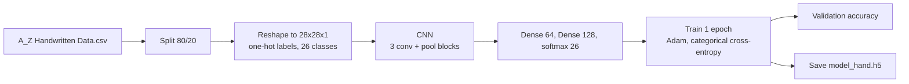

# InkSense

Handwritten letter recognition (A to Z) with a small convolutional neural network in Keras.

 

## Problem

Classify a 28x28 grayscale image of a handwritten capital letter into one of 26 classes.

## Dataset

[A-Z Handwritten Alphabets in CSV format](https://www.kaggle.com/sachinpatel21/az-handwritten-alphabets-in-csv-format) (Kaggle). Each row is a label (0 to 25, for A to Z) followed by 784 pixel values. The file is large and **not included**. Download `A_Z Handwritten Data.csv` and place it in `data/`. The dataset's license is not documented here, so check the Kaggle page before reuse.

The notebook's saved output shows a split of 82,103 training and 20,526 test images.

## Method



- **Architecture:** `Conv2D(32, 3x3)` then `MaxPool`, `Conv2D(64, 3x3, same)` then `MaxPool`, `Conv2D(128, 3x3, valid)` then `MaxPool`, `Flatten`, `Dense(64)`, `Dense(128)`, `Dense(26, softmax)`. ReLU activations.
- **Training:** Adam (learning rate 0.001), categorical cross-entropy, 1 epoch.
- **Exploration:** a class-count bar chart and a 3x3 grid of sample images.

## Results

From the saved notebook output (1 epoch, the held-out 20% used as validation data):

| Run | Training accuracy | Validation accuracy | Validation loss |
|---|---|---|---|
| First training cell | 95.53% | 97.96% | `nan` |
| Second training cell | 95.71% | 98.06% | `nan` |

The notebook trains the same architecture twice with identical settings. The validation loss is reported as `nan` in both runs, and its cause has not been investigated, so treat the accuracy figures with caution.

## How to run

```bash
git clone https://github.com/Praneetha1844/CodeAlpha_HandwrittenCharacter_Detection.git
cd CodeAlpha_HandwrittenCharacter_Detection
python -m venv .venv && source .venv/bin/activate   # Windows: .venv\Scripts\activate
pip install -r requirements.txt jupyter
# download "A_Z Handwritten Data.csv" into data/
jupyter notebook notebooks/inksense_az_cnn.ipynb
```

The notebook reads `../data/A_Z Handwritten Data.csv`, relative to the `notebooks/` folder. It writes the trained model to `model_hand.h5`, which is ignored by git.

## Repository structure

```
.
├── notebooks/inksense_az_cnn.ipynb   # exploration, training, evaluation
├── data/                             # place the CSV here (not tracked)
├── requirements.txt
├── .github/workflows/ci.yml          # validates notebooks, resolves dependencies
└── LICENSE
```

## Limitations and notes

- Trained for a single epoch, with no pixel scaling, no data augmentation and no hyperparameter search.
- The split has no fixed random seed, so results are not exactly reproducible.
- The 20% held-out set is used as validation data. There is no separate test set.
- Only overall accuracy is reported. There is no per-class accuracy or confusion matrix.
- The saved output of the last figure cell was cleared. It had titled the true labels "Prediction". It now titles them "Label", and the notebook does not yet plot the model's own predictions.
- The model recognises single capital letters on clean 28x28 images. It was not tested on lowercase letters, digits, whole words or photographs.

## Future work

- Scale inputs, add augmentation and train for more epochs with early stopping.
- Find and fix the `nan` validation loss.
- Add a held-out test set, a confusion matrix and plots of real model predictions.
- Wrap inference in a small tested module and a demo.

## License

MIT. See [LICENSE](LICENSE).
